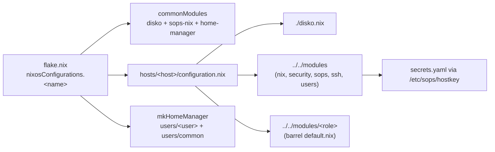

# Repository Guidelines

## Project Overview

`genix` is the NixOS flake that declaratively manages every machine used at GEHACK competitive-programming contests (FPC, EAPC, EUC26): contest workstations, the network gateway, the scoreboard kiosk, and a live ISO. There is no imperative provisioning — a machine's entire state is one `nixosConfigurations` attribute.

Upstream: `git@github.com:GEHACK/genix.git`. Contestant-facing docs are published from `docs/` to `os.gehack.nl`.

## Architecture & Data Flow

Single composition point (`flake.nix`) → thin host file → module barrel → per-concern module.



Four layers, in evaluation order:

1. **`flake.nix`** — declares contest-wide facts as `specialArgs`: `dj_url`, `loom_url`, `geproxy_ip = "10.0.0.1"`, `contest_subnet = "10.0.0.0/24"`, `admin_ip = "10.0.1.1"`, `admin_subnet = "10.0.1.0/24"`, `imaged_port = 8080`. Builds each system as `commonModules ++ <role-specific flake-input modules> ++ mkHomeManager {...} ++ ./hosts/<host>/configuration.nix`.
2. **`hosts/<host>/configuration.nix`** — the *only* thing that imports `modules/`. Contains just `imports = [ ./disko.nix ../../modules ../../modules/<role> ];`, hardware facts, and a declarative toggle block. No logic.
3. **`modules/`** — `modules/default.nix` is a barrel imported by every host; `modules/<role>/default.nix` is a barrel of single-concern files.
4. **`users/`** — **home-manager modules only**, wired in `flake.nix` via `mkHomeManager`. They never contain `users.users.*`.

**The option router** (`modules/teammachine/user-tools.nix`) is the key non-obvious mechanism:

```nix
config.home-manager.users = lib.mapAttrs (_name: userCfg: { teammachine = userCfg; }) config.teammachine.users;
```

So `teammachine.users.team.languages.cpp.enable = true` in the host file becomes `home-manager.users.team.teammachine.languages.cpp.enable`. An entire workstation is configured from one block in `hosts/teammachine/features.nix`, which the laptop (`hosts/teammachine`) and the venue machine (`hosts/teammachine-part`) both import; each keeps only its own hardware.

**Secrets flow one way**: `modules/sops.nix` binds every host to `secrets.yaml`, decrypted with the age key at `/etc/sops/hostkey`. Modules declare `sops.secrets.<name> = { owner; group; mode; }` and consume `config.sops.secrets.<name>.path` — never the value.

**Deployment** is either direct (`nixos-anywhere` → disko → toplevel) or relayed through geproxy's custom `services.buildFanout` (`modules/geproxy/fanout.nix`), an SSH forced-command dispatcher that intercepts nixos-rebuild's own SSH protocol and re-fans the closure to every laptop in loom's inventory.

## Key Directories

| Path | Purpose |
|---|---|
| `flake.nix` | Sole composition point: inputs, `specialArgs`, module lists, all outputs |
| `hosts/<host>/` | `configuration.nix` + `disko.nix`. Thin — hardware + toggles only |
| `modules/` | Base modules applied to every host (`loomd`, `nix`, `security`, `sops`, `ssh`, `users`) |
| `modules/teammachine/` | Contest laptop: greetd/loom-greeter, GNOME, nftables, printer, PXE, usbguard |
| `modules/geproxy/` | Gateway: `network/` (bridges, dnsmasq/PXE, nftables, Caddy, wifi access points), loom backend, imaged, cuproxy, balloons, fanout, tunnelrs connector |
| `modules/partition/` | Venue machines (`teammachine-part`, `teammachine-part-base`, `judgehost-part`): one btrfs partition chainloaded by the host's GRUB, the dd-able image, `teammachine-reset` |
| `modules/scoreboard-laptop/` | `cage` Wayland kiosk running the ICPC presentation client |
| `users/common/` | HM `sharedModules`: declares `teammachine.languages.*`, firefox policy, nixvim |
| `users/team/`, `users/gehack/` | Per-user HM profiles |
| `scripts/` | Deploy wrappers (see the `format.sh` warning below) |
| `assets/` | Media consumed **by Nix** (wallpaper, Plymouth logo) — unrelated to `docs/assets/` |
| `docs/` | Jekyll site (github-pages gem, cayman theme) for contestants |

## Development Commands

```bash
# Build-check a host — the closest thing to CI this repo has
nix build .#nixosConfigurations.teammachine.config.system.build.toplevel
nix build .#nixosConfigurations.geproxy.config.system.build.toplevel
nix build .#nixosConfigurations.scoreboard-laptop.config.system.build.toplevel

# VM smoke test (teammachine → host port 2222, geproxy → 2223)
nix build .#packages.x86_64-linux.teammachine-vm
./result/bin/run-*-vm
ssh -p 2222 root@localhost

# Build the live ISO
nix build .#packages.x86_64-linux.teammachine-iso

# Provision bare metal (prefer the wrapper over the raw nixos-anywhere call)
./scripts/nixos-anywhere.sh <FLAKE_TARGET> root@<IP>
./scripts/nixos-anywhere.sh -J <jump> -i <key> --extra-files ./tmp \
  --chown /etc/sops/hostkey root:root <FLAKE_TARGET> root@<IP>
# Fast provisioning: build on geproxy, target on the admin net pulls from geproxy's cache
./scripts/nixos-anywhere.sh -B gehack@geproxy.gehack.nl --cache http://10.0.1.1:5000 \
  --extra-files ./tmp --chown /etc/sops/hostkey root:root <FLAKE_TARGET> root@<IP>

# Deploy an update
./scripts/install.sh <FLAKE_TARGET> root@<IP>   # remote — NO confirmation prompt
./scripts/install.sh <FLAKE_TARGET>             # local, sudo, prompts

# ARM cross-deploy (the wrappers do not support this — no --build-host)
nixos-rebuild switch --flake .#teammachine_arm \
  --target-host root@<IP> --build-host root@<IP> \
  --option builders "ssh://root@<IP>"

# Secrets
sops secrets.yaml                 # only legal way to edit
sops updatekeys secrets.yaml      # after adding a recipient to .sops.yaml
sops secrets-teammachine.yaml     # teammachine-part copies of the five teammachine secrets
sops secrets-judgehost.yaml       # judgehost-part copies of the four judgehost secrets

# SSH keys / inputs
./scripts/update_keys.sh
nix flake update
```

**There is no lint or format command.** `flake.nix` exposes no `formatter` or `devShells` output, and no nixfmt/treefmt/alejandra/statix config exists anywhere (grep-verified). `nix fmt` and `nix develop` do nothing useful; `checks` holds only VM tests. Match surrounding style by hand and verify with `nix build`.

> **`scripts/format.sh` is a disk formatter, not a code formatter.** It runs `disko --mode destroy,format,mount` against the *current* host. Never run it to tidy Nix files. Its `--flake ".#…"` ref is CWD-relative, so it must run from the repo root — README's `cd scripts` instruction is wrong.

### Flake targets

`nixosConfigurations`: `teammachine`, `teammachine-part`, `teammachine-part-base`, `judgehost-part`, `teammachine_arm`, `geproxy`, `scoreboard-laptop`, `scoreboard-laptop_arm`, `teammachine-iso`.

`packages.x86_64-linux`: `teammachine`, `teammachine-part` (`teammachine.img.zst` of the small `teammachine-part-base`, a single-partition btrfs image written with plain `dd`; the full `teammachine-part` follows through imaged or a deploy), `judgehost-part` (the same kind of image of the full `judgehost-part`, also named `teammachine.img.zst`), `geproxy`, `scoreboard-laptop`, `teammachine-vm`, `geproxy-vm`, `teammachine-iso`.
`packages.aarch64-linux`: `teammachine-arm`, `scoreboard-laptop-arm`.

Note the naming split: **underscore** in `nixosConfigurations` (`teammachine_arm`), **hyphen** in `packages` (`teammachine-arm`). The `*-vm` targets exist only as packages — `nixos-rebuild --flake .#teammachine-vm` fails.

## Code Conventions & Common Patterns

**Barrel imports.** Every module directory has a `default.nix` that is *only* an `imports` list. A new file is dead code until it is added there.

```nix
# modules/<role>/default.nix
_: {
  imports = [ ./boot.nix ./desktop.nix ./networking.nix ];
}
```

**Argument heads.** `_:` when no arguments are used; otherwise destructure exactly what is needed and always end with `, ... }:`. `specialArgs` are destructured directly:

```nix
{ pkgs, lib, config, geproxy_ip, contest_subnet, ... }:
```

**Opt-in feature modules** — the dominant shape, used across `modules/teammachine/*` and `modules/geproxy/fanout.nix`:

```nix
let cfg = config.teammachine.webcamstream;
in {
  options.teammachine.webcamstream.enable = lib.mkEnableOption "webcam stream";
  config = lib.mkIf cfg.enable { /* … */ };
}
```

**Option namespaces**: system toggles under `teammachine.*` / `scoreboard.*`; the fanout mimics upstream naming as `services.buildFanout.*`. Home-manager options *also* live under `teammachine.*` — same prefix, different module system.

**Naming is layered and deliberately inconsistent**: kebab-case files and dirs (`user-tools.nix`, `netboot.nix`), camelCase `let` bindings (`operatorKeys`), snake_case `specialArgs` (`dj_url`, `geproxy_ip`). Secrets are kebab-case (`fanout-ssh-key`) or dotted namespaces (`balloons.domjudge.user`, quoted in Nix).

**Contest facts flow via `specialArgs`, not options.** Changing `geproxy_ip` in `flake.nix` rewrites every laptop's firewall, geproxy's own ruleset, dnsmasq and the PXE chain.

**Secrets by path, never by value.** Multi-value secrets use `sops.templates` with `config.sops.placeholder.*` (see `modules/geproxy/balloons.nix`) rather than shell-time concatenation.

**Firewall: nftables only — never introduce iptables rules.** Both roles set `networking.firewall.enable = false` plus `networking.nftables` with `checkRuleset = true`. The teammachine ruleset is an inline string in `modules/teammachine/networking.nix` that drops by default in both directions: out it allows only DHCP, mDNS, ICMP and the geproxy ports the laptops use (DNS, NTP, 80/443, printing, the cache, imaged), in only SSH, RDP and the streams port from geproxy and the admin subnet, where geproxy is `geproxy_ip` or the discovered set `@geproxy`. A new service that talks to geproxy needs its port there; geproxy's is generated by `modules/geproxy/network/firewall.nix` from the `geproxy.networks`/`uplink`/`ports`/`proxy.sites` options set in `hosts/geproxy/configuration.nix`.

**Inline derivations, minimal overlays.** External packages come from flake-input `nixosModules`, `_module.args`, or the flake-input overlays in `packageOverlays` (`flake.nix`). Local packages are `pkgs.writeShellApplication` / `writeShellScriptBin` / `stdenv.mkDerivation` inline in the consuming module. The only local overlay is `modules/teammachine/languages.nix`: setting `teammachine.languages.kotlin.pin = { version; hash; }` in a host file swaps nixpkgs' `kotlin` for that JetBrains release everywhere (including `mykotlinc`); `null` (the default) keeps the nixpkgs version.

**The team machines' contest toolchain comes from one place; the judge's does not.** The only other local overlay, also in `modules/teammachine/languages.nix`, defines `pkgs.contestToolchain` (`gcc`, `pypy3`, `jdk`, `kotlin`). Every contest-language reference in `users/team/*` goes through it. The judge does not use it: `modules/judgehost/judgedaemon.nix` runs `ghcr.io/gehack/judgehost` (built from the `ubuntu-fix` branch of GEHACK/domjudge-packaging, pinned by manifest digest), whose own Ubuntu 26.04 chroot carries gcc 15.2, pypy3 7.3.20, OpenJDK 21 and Kotlin from JetBrains. Those match the team machines closely, not by store path. Two traps:
- Build the toolchain from `final`, never `prev`. nixpkgs' stdenv swaps its bootstrap gcc into `gcc` *after* user overlays, so `prev.gcc` is a different compiler from the `pkgs.gcc` the team machines run, and `.override` on the wrapper rebuilds gcc too. `contestToolchain.gcc` is `final.gcc` with `glibc.static` appended to `nix-support/cc-ldflags` via `overrideAttrs`, so `-static` works without `-L` while `cc`, `bintools` and `libc` stay the identical store paths.
- A Kotlin or language bump here does not reach the judge. Bump `KOTLIN_VERSION`/`KOTLIN_SHA256` in domjudge-packaging's `docker/judgehost/chroot-and-tar.sh` alongside, rebuild the image, and re-pin it in `judgedaemon.nix`.

**`mkForce` appears only in the ISO and the venue machines**: `modules/partition` disables GRUB, because the host's own GRUB chainloads the UKI that the `boot.loader.external` hook writes to `/boot/teammachine.efi`, and moves the sops key to `/persist/sops/hostkey`, so it survives `teammachine-reset`. `hosts/teammachine-part` and `hosts/judgehost-part` override `sops.defaultSopsFile` with their own secrets file. `mkIf` is the standard conditional; `mkDefault` is unused.

**Commits**: recent history uses Conventional Commits (`feat:`, `chore:`) without scopes; older history is free-form. Follow `feat:`/`fix:`/`chore:`. Branches are `<type>/<kebab-slug>`.

## Important Files

| File | Why it matters |
|---|---|
| `flake.nix` | Inputs, `specialArgs`, `commonModules`, `mkHomeManager`, `mkVmModule`, all outputs |
| `modules/default.nix` | Base barrel every host gets |
| `modules/sops.nix` | The entire secrets wiring: `keyFile = "/etc/sops/hostkey"`, `defaultSopsFile = ../secrets.yaml` |
| `modules/users.nix` | `mutableUsers = false`, the `gehack` admin, root keys from `../authorized_keys` |
| `modules/teammachine/user-tools.nix` | `teammachine.users` → home-manager router |
| `modules/geproxy/fanout.nix` | 250-line SSH forced-command deploy relay |
| `modules/geproxy/network/` | Options (`options.nix`) and generators for bridges, per-network dnsmasq, the nftables ruleset, Caddy + ACME with the authentik login, wifi access points, internet toggle tools |
| `hosts/geproxy/configuration.nix` | The geproxy overview: networks, reachability, internet mode, allowed services, which proxy site is exposed on which port per network, and which sites are tunnelled |
| `users/team/languages.nix` | The real home of `mygcc`/`mygpp`/`mypython`/`myjavac`/`mykotlinc` |
| `authorized_keys` | **Generated.** Edit `USERS` in `scripts/update_keys.sh` instead |
| `fanout_pubkey` | Hand-maintained; grants geproxy root access to laptops |
| `.sops.yaml` | Operator recipients plus three host keys: `&host-key` for `secrets.yaml`, `&teammachine-key` for `secrets-teammachine.yaml`, `&judgehost-key` for `secrets-judgehost.yaml` |
| `README.md` | Operator manual — accurate on intent, stale in several specifics (below) |
| `bartjan.md` | Personal scratch notes with a hardcoded LAN IP. Not authoritative |

## Runtime/Tooling Preferences

- **Nix with flakes**, `nixpkgs` pinned to `nixos-26.05`. Only 5 of 11 inputs `follow` nixpkgs — `disko`, `loom`, `cuproxy`, `balloons`, `imaged` and `tunnelrs` (nixos-unstable) carry their own. Adding `inputs.nixpkgs.follows` is a behaviour change, not a cleanup.
- `nixConfig` declares two substituters: `luukblankenstijn.cachix.org` and `gehack.cachix.org`. Only honoured for trusted Nix users; otherwise every Rust/Go input builds from source.
- `sops` + an age key listed in `.sops.yaml` is required to touch secrets.
- `nixos-anywhere` is pinned as `packages.x86_64-linux.nixos-anywhere` (nixpkgs' package). Its kexec step makes the *target* download the installer from GitHub, so run `enable-internet` on geproxy before installing a machine on the contest network. `disko` is still invoked ad-hoc via `nix run github:nix-community/disko`. There is no devShell.
- `system.stateVersion = "25.11"` on every host while nixpkgs is `26.05`. **Intentional — never "fix" it.**
- `home-manager.useGlobalPkgs = true`, so `nixpkgs.config` inside HM modules is ignored; `allowUnfree` must be set at the host level.

## Testing & QA

There is **no CI** — no `.github/` directory exists, nothing validates a push. `checks.x86_64-linux` holds two NixOS VM tests (`teammachine-rdp`, `geproxy-network`); run the geproxy one after touching `modules/geproxy/network/`. Verification is otherwise manual and mandatory:

1. `nix build .#nixosConfigurations.<host>.config.system.build.toplevel` — catches evaluation and build errors.
2. `nix build .#packages.x86_64-linux.teammachine-vm && ./result/bin/run-*-vm` — boot and `ssh -p 2222 root@localhost` for behavioural changes.
3. Build every host you may have touched. Base modules under `modules/` affect all six configurations, and `teammachine-iso` must be built separately (see below).

## Footguns

Non-obvious traps, all verified against source:

- **`scripts/format.sh` destroys disks.** See the warning above. This is the single most dangerous name collision in the repo.
- **`install.sh` remote mode has no confirmation prompt** and immediately `switch`es a live host.
- **Both deploy scripts run `update_keys.sh` first**, which requires network access to github.com, hard-fails offline, and silently `git add`s `authorized_keys` into your index.
- **`nixos-anywhere.sh -B` needs a trusted Nix user on the build host.** It sends the flake with `nix flake archive --to ssh-ng://…`, builds `toplevel`, `diskoScript` and `nixos-anywhere` there under GC roots in `~/.local/state/genix-provision`, and runs nixos-anywhere with `--store-paths`. geproxy trusts `gehack` and uses both cachix caches via `modules/geproxy/build-host.nix`, which reads them from `flake.nix`'s `nixConfig`. Only files tracked by git reach the build host.
- **`nixos-anywhere.sh --cache` only works for targets on the admin net.** `modules/geproxy/cache.nix` serves geproxy's whole store with harmonia (unsigned, zstd) on port 5000, allowed only on `admin`. The script splits nixos-anywhere into `--phases kexec` and `disko,install,reboot`, and in between writes `substituters = <cache>` and `require-sigs = false` into the installer's `/root/.config/nix/nix.conf`, so the target substitutes the closure in parallel over HTTP (measured ~9.5× faster than the ssh copy). The cache must be the build host, since only paths in its store are served. Without a reachable cache, the paths should still arrive over the slow ssh copy after the 5 s `connect-timeout`, but that fallback is untested.
- **`authorized_keys` is generated and parsed by Nix.** `modules/geproxy/default.nix` reads it at eval time and filters `#`-prefixed lines into `services.buildFanout.authorizedKeys`, so the `# <username>` comment format is load-bearing. Hand edits are clobbered on the next deploy.
- **The ISO is a fork, not a variant.** `hosts/teammachine-iso/configuration.nix` uses `disabledModules = [ ../../modules/users.nix ]`, re-declares users inline with a literal `hashedPassword`, and imports **9 specific `modules/teammachine/*` files by path** rather than the barrel. Adding a file to `modules/teammachine/default.nix` does not reach the ISO; renaming one of those 9 breaks it. `networking.nix`, `printer.nix` and `netboot.nix` read `teammachine.geproxy.host`, so `geproxy.nix` must stay in that list. Never copy the literal-password pattern into a real host.
- **`teammachine.users` is `types.attrsOf types.attrs`** — typos are silently accepted at the NixOS layer and only explode inside home-manager, or not at all. `scoreboard-laptop` loads HM with *no* users, so `teammachine.users.*` there does nothing.
- **`modules/scoreboard-laptop/scoreboard.nix` is a package, not a module.** It is deliberately absent from the barrel and `callPackage`d from `desktop.nix`. Adding it to `default.nix` breaks evaluation.
- **`.#contestlaptop` does not exist** despite the comment at the top of `modules/geproxy/fanout.nix`. Use `.#teammachine`.
- **`enable-internet`/`disable-internet` are not declarative.** They mutate the live `chain <network>_inet` of every `internet = "switchable"` network; any `nixos-rebuild switch` reloads the ruleset and resets internet to disabled.
- **The DNS kill switch matches dnsmasq by user name** (`meta skuid "dnsmasq-<network>"`). nft resolves the name when the ruleset loads; the build-time check substitutes `nobody` via `preCheckRuleset`. Renaming the dnsmasq users breaks both.
- **A proxy site not listed in `expose` for a network answers 404 there**, even on a port other sites opened; Caddy guards on `remote_ip` of the network subnets. Clients on the uplink have no known subnet, so a site exposed on the uplink can only exclude LAN subnets.
- **Finding geproxy without its fixed address is opt-in on both ends.** `geproxy.uplink.announce` starts a dnsmasq on the uplink that answers the proxy sites exposed on the uplink with the uplink's current address, and opens mDNS and DNS there; resolved answers `geproxy.local` over mDNS on every link. `teammachine.geproxy.discover` resolves `geproxy.local`, puts the address in the nftables set `geproxy` and points DNS for `gehack.nl` at it; services then use `teammachine.geproxy.host` instead of `geproxy_ip`.
- **Every host with `services.loomd.label` runs loomd** (`modules/loomd.nix`): `team` on the teammachines (`modules/teammachine/station.nix`), and `judgehost`, `cds` and `utility` in their host files. Greeter integration and the registration tool follow `services.greetd.enable`, so only teammachines get them. geproxy and the ISO set no label and run none.
- **`monitoring.enable` pushes metrics and the journal to geproxy** (`modules/monitoring.nix`; on for the teammachine role, `judgehost` and `utility`): Grafana Alloy scrapes the local node exporter and reads the journal, and sends both to `https://metrics.gehack.nl` with a bearer token. The token is `monitoring.token`, root-only on the machines and handed to Alloy as a systemd credential; geproxy's Caddy compares it with `{file.…}` in a `header` matcher (a CEL `expression` does not substitute that placeholder) and passes only `/api/v1/write` (VictoriaMetrics) and `/loki/api/v1/push` (Loki). Series carry `host` and `machine` (`/etc/machine-id`), because every teammachine is called `team`. Grafana (`grafana.gehack.nl`, admin and tunnel) sits behind the authentik login and trusts everyone past it as Admin.
- **`geproxy.judge.upstream` decides which DOMjudge the `judge` site serves** (`modules/geproxy/judge.nix`, default `dj_url`). When it points at a DOMjudge in geproxy's own networks, geproxy also resolves the judge host to itself, so balloons and loom keep using `dj_url` and reach that DOMjudge through Caddy, which then also covers a self-signed upstream with `insecureUpstream`.
- **loom runs on geproxy, not in a cluster.** `loom.nixosModules.loom-backend` serves the dashboard, `/api`, `/rpc` and the station gRPC on `127.0.0.1:3010` with SQLite in `/var/lib/loom`. Laptops reach it as `loom.gehack.nl` because dnsmasq answers proxy hosts with geproxy's address; geproxy's own consumers (fanout inventory, cuproxy webhooks, `team.loom` DNS) get there through `networking.hosts`. A fresh deploy starts with an empty database.
- **Sites with `login` are guarded by the GEWIS authentik** (`geproxy.proxy.authentik`), through Caddy `forward_auth` against its embedded outpost. The forward-auth provider for each host lives in authentik, not here. Caddy strips client-sent `X-Proxy-Authorized` and sets it after a login; loom's backend (`trustedProxyHeader`) treats it as admin. Station gRPC (`Content-Type: application/grpc`, bearer token) and `/api/*` skip the login, as in the old k8s ingress.
- **`geproxy.tunnel` publishes sites with `tunnel` through tunnelrs** (server `5387b0ee…` behind `relay.luukblankenstijn.nl:8443`) with TLS passthrough to Caddy on loopback, so geproxy's own certificate is served and the edge cannot add HTTP middleware. The connector key is `tunnelrs.key`; a new key stays `pending` until `tunnelrs-ctl approve <id>` on the server.
- **All hosts share one age identity at `/etc/sops/hostkey`, and nothing in the repo provisions it**, except the venue machines, which have their own (next entry). Stage it locally and pass `--extra-files` + `--chown`; `.gitignore` carries `tmp/` for exactly this. Without it, the `setupSecretsForUsers` activation snippet fails and every user with `hashedPasswordFile` stays without a password. Boot still continues and root SSH by key works. Services that need secrets do not work.
- **The venue machines use their own keys at `/persist/sops/hostkey`**: `teammachine-part` reads `secrets-teammachine.yaml` with `&teammachine-key` (private half `teammachine-hostkey` in `secrets.yaml`), `judgehost-part` reads `secrets-judgehost.yaml` with `&judgehost-key` (private half `judgehost-hostkey`). Neither key decrypts `secrets.yaml` or the other file. Both files hold copies of secrets from `secrets.yaml`, so changing one of those means editing both files. The built images carry no key; push it over SSH. Switching a machine's role means pushing the other key.
- **The venue machines must keep `systemd.gpt_auto=0`** (`modules/partition`). Without it, systemd auto-mounts the venue's ESP at `/efi` and `bootctl` creates `\loader\random-seed` there. After that, systemd-stub rewrites that file on every boot.
- **The venue partition is one btrfs filesystem with label `teammachine`**, mounted by label, with subvolumes `root`, `nix`, `boot` and `persist`, grown on boot (`autoResize`). A second partition with that label on the same machine makes the root device ambiguous. GRUB resolves `/boot/teammachine.efi` from the top level, where it is the `boot` subvolume, so moving the UKI into `root` breaks the host entry. `teammachine-reset` replaces only `root` with `snapshots/root-pristine`; state that must survive a reset belongs in `/persist`, `/nix` or `/boot`.
- **The image's files must be owned by root.** `mkfs.btrfs --rootdir` records the uid it sees, so the image build runs it under `unshare --map-root-user`; fakeroot does not reach it, and a uid-1000 store breaks sshd, dhcpcd and nscd.
- **The imaged kernel brings up only i915 among GPU drivers** (imaged `ab61b76`). `imaged-boot` kexecs, and the old kernel's DRM driver switches the display off on the way out, so a machine whose screen is driven by amdgpu, nouveau or xe stays dark in imaged, although the agent still runs and shows up in the dashboard.
- **`imaged-boot` must match the imaged server's routes.** It fetches `/boot/<linuxArch>/vmlinuz` and `/boot/<linuxArch>/initramfs.cpio.xz` (`modules/teammachine/netboot.nix`), the paths `crates/boot/src/pxe.rs` serves since imaged `fddffb5`. Bumping the input can move them again.
- **`secrets.yaml` may only be edited with `sops secrets.yaml`.** It has a MAC; any other write corrupts it. `&kevin` is an `ssh-ed25519` key inside the `age:` group — intentional, do not normalise it to `age1…`.
- **`users.mutableUsers = false`** everywhere: `passwd` on a host is a no-op.
- **No `hardware-configuration.nix` exists anywhere.** Hardware facts (PCI bus IDs, NIC names, disk paths) are hand-written into `hosts/<host>/configuration.nix` and `disko.nix`. Never "regenerate" one.
- **Root partitions have a fixed size, not `100%`**: `100G` on `teammachine`, `scoreboard` and `balloons` (the `utility` image grows its root to the whole disk on deploy instead), `450G` on `cds` and `judgehost` (issue #66). Only `geproxy` keeps `100%` on its RAID. The rest of the disk stays unallocated so imaging and capture only copy what is partitioned. disko fails on a disk smaller than the partition.
- **Hostname ≠ flake attribute**: `teammachine` produces `networking.hostName = "team"`; `scoreboard-laptop` sets none.
- **The contest id lives only in `flake.nix`** as the `contest_id` specialArg. Balloons consumes it directly; the scoreboard laptop ships the literal `__CONTEST__`, which geproxy's Caddy rewrites in the request path for sites with `rewriteContest = true` (`judge`, `cds`). A new contest therefore rebuilds geproxy only.
- **`README.md` is stale in specifics**: its `authorized_keys` member list omits `mexdeloo`/`kevinjil` and lists a non-existent `zeo`; it cites `modules/teammachine/languages.nix` which does not exist (real path: `users/team/languages.nix`); it places DevDocs on the teammachine when it is a container on geproxy; it lists one cachix substituter when there are two; and it never mentions `scripts/nixos-anywhere.sh`. Trust the source.
- **`.gitignore` covers `CLAUDE.md` and `.claude` but not `AGENTS.md`** — this file is tracked.
