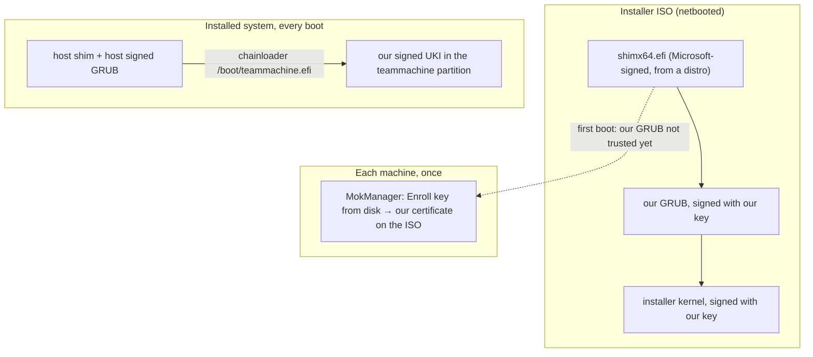

# Teammachine partition installer

Status: design, not implemented. A prototype of the partition system and a local install script exists in the working tree of the author (see [Prototype](#prototype)); the installer ISO and Secure Boot parts are not built.

## Goal

Install the teammachine system into **one existing partition** of an existing machine, without touching anything else on its disk.

- The machine already has a disk with several partitions, its own OS and its own GRUB.
- The venue admin adds a boot entry for the teammachine partition to that GRUB by hand. That GRUB is **not managed by Nix**.
- Nix is confined to the teammachine partition: it never mounts or writes the ESP or any other partition, also not on rebuilds.
- The install is done by the venue admin, not by us. The only thing they can do is **netboot an ISO**.
- Secure Boot is **on** at the venue. It can be turned off, but should preferably stay on.

## Decisions

| Topic | Decision |
|---|---|
| Delivery | A small installer ISO that is netbooted; it downloads the system after boot |
| Payload source | An HTTP server we host; the URL is baked into the ISO |
| Target partition | Chosen automatically by GPT partition name `teammachine`; refuse when zero or more than one partition matches |
| Secrets key | `/etc/sops/hostkey` is baked into the ISO, spliced in **outside** Nix |
| Partition boot | A signed unified kernel image (UKI) at a fixed path inside the partition, chainloaded by the host GRUB |
| Secure Boot | Supported via a Microsoft-signed shim plus our own key, enrolled once per machine through MokManager |

## Why the ISO is a small downloader

Netbooting an ISO (UEFI HTTP Boot, iPXE `sanboot`, memdisk) typically loads the whole file into RAM, or exposes it through firmware only until the kernel starts. Consequences:

- The full teammachine closure is 33.2 GiB (JetBrains IDEs alone are ~12 GiB). It cannot be carried in a netbooted ISO.
- A regular NixOS ISO finds its squashfs store by volume label after the kernel starts. When netbooted, that medium is often invisible to Linux and boot stops.

So the ISO wraps a NixOS **netboot** kernel and initrd (`system.build.netbootRamdisk`, which embeds the squashfs store in the initrd). After the bootloader has loaded kernel and initrd, the ISO is never needed again, whatever netboot method the venue uses. The installer then streams the system from our HTTP server.

## Components

### 1. Partition system (`teammachine-part`)

The regular teammachine configuration plus:

- `disko.enableConfig = false`: no partlabel-based mounts from `hosts/teammachine/disko.nix`.
- `fileSystems."/"` by filesystem label `teammachine`; no `/boot` filesystem, the ESP is never mounted.
- GRUB disabled (`boot.loader.grub.enable = lib.mkForce false`).
- A boot hook (`boot.loader.external`) that on every `switch-to-configuration boot|switch` writes the UKI for the new generation to `/boot/teammachine.efi` inside the partition. With Secure Boot, the file must be signed (see [Signing rebuilds](#signing-rebuilds)).

Image: `make-disk-image.nix` with `partitionTableType = "none"` produces a bare ext4 filesystem (label `teammachine`) containing the store, the Nix database and the `system` profile. It is published zstd-compressed on the HTTP server.

### 2. Installer ISO

A minimal NixOS netboot system (curl, zstd, e2fsprogs, util-linux, gptfdisk) wrapped in an ISO that boots on UEFI (and BIOS where possible). On boot it runs one unit:

1. Find the target: exactly one partition with GPT name `teammachine`, otherwise stop with a clear message on screen.
2. Refuse when the partition is mounted, too small, or another partition already carries filesystem label `teammachine`.
3. `curl <url> | zstd -d | dd of=<partition>`, then `e2fsck -fp` and `resize2fs`.
4. Mount it, install `/etc/sops/hostkey` (mode 0400, root), unmount.
5. Show the host GRUB entry and power off.

### 3. Host GRUB entry (written by the venue admin, once)

```
menuentry "Teammachine" {
    search --no-floppy --label teammachine --set=root
    chainloader /boot/teammachine.efi
}
```

The entry never changes: kernel, initrd and kernel parameters all live in the UKI, which every rebuild replaces in place.

## Boot chains



- MOK enrolment is stored in NVRAM and honoured by every shim on the machine, including the host distro's shim. One enrolment covers both the installer and the installed system.
- With Secure Boot off, the same signed binaries boot unchecked.

## Secure Boot

- **Shim**: use the newest available Microsoft-signed shim (e.g. current Debian `shim-signed`) together with its MokManager (`mmx64.efi`). An up-to-date host shim may already have written a raised `SbatLevel` to NVRAM, which revokes older shim/GRUB generations on that machine.
- **GRUB**: built with the `shim_lock` verifier and an `.sbat` section whose `grub` generation is at least upstream's current one; shim refuses binaries without SBAT.
- **Kernel modules**: if the kernel enforces module signatures under Secure Boot, the unsigned NVIDIA module will not load. Needs a check on real hardware.
- **Venue netboot**: with Secure Boot on, the venue's own netboot loader (iPXE / UEFI HTTP Boot) must be signed. Nothing on our ISO can compensate if it is not.

### Signing rebuilds

Every rebuild produces a new UKI that needs a signature. Open decision:

| Option | How | Risk |
|---|---|---|
| a. Sign on the machine | Signing key in `secrets.yaml`, signed during activation | Root on one teammachine yields a key trusted by every enrolled machine |
| b. Sign on a trusted deploy machine (preferred) | A deploy wrapper builds the UKI, signs it locally, copies the signed file into the partition | Updates must go through the wrapper instead of plain `nixos-rebuild`; a missing signature only shows at boot |

## Key handling

Nothing secret enters a Nix build: `/nix/store` is world-readable on every builder and the installer closure could be pushed to the public `gehack` / `luukblankenstijn` Cachix.

`scripts/build-installer-iso.sh` (to be written) post-processes the key-free ISO built by Nix:

1. `sbsign` GRUB and the installer kernel with the signing key.
2. Append a cpio archive containing `/etc/sops/hostkey` to the initrd (the kernel unpacks concatenated cpio archives).
3. Repack the ISO with `xorriso`.

The resulting ISO is a secret: anyone holding it can decrypt `secrets.yaml`. Hand it to the venue admin over a trusted channel only.

## Verification

A NixOS VM test (`tests/teammachine-part.nix`, exposed as `checks.x86_64-linux.teammachine-part`) using a stripped-down partition system (base modules + partition module + test instrumentation; the full 33 GiB system is too large for a check):

1. Build an "existing machine" disk: ESP with a hand-written GRUB config, an existing OS partition, a data partition with files, and a target partition with GPT name `teammachine` filled with old data.
2. Boot that disk under UEFI; confirm the existing OS boots via its GRUB.
3. Netboot the installer ISO in the VM against a local HTTP server; confirm it installs into the named partition and refuses when the name is missing or duplicated.
4. Add the host GRUB entry by hand, boot the teammachine, check hostname and root label, and checksums of the ESP and data partition.
5. Rebuild to a second generation, reboot through the unchanged entry, check the new generation runs and the ESP is still untouched.
6. Boot back into the existing OS.

Secure Boot stage: the same test with OVMF using Microsoft-enrolled variables and a pre-seeded recent `SbatLevel`, MokManager enrolment driven by key presses, and a negative check that an unsigned UKI is refused.

## Plan

1. Without Secure Boot: partition system with UKI hook, installer ISO, VM test.
2. With Secure Boot: shim + signing pipeline, Secure Boot VM test.

## Open questions

- Which HTTP server hosts the image, and is it reachable from the network the venue machines netboot on? (geproxy's nftables only exposes some ports to the contest network.)
- Signing option a or b.
- Is the target hardware the same laptop model? `hosts/teammachine/configuration.nix` hard-codes NVIDIA PRIME bus IDs; on other hardware the graphical session will likely fail.

## Prototype

Not committed; in the author's working tree:

- `hosts/teammachine-part/configuration.nix`: label-based root, no bootloader, `system.build.partitionImage`.
- `flake.nix`: `nixosConfigurations.teammachine-part`, `packages.x86_64-linux.teammachine-part`.
- `scripts/install-partition.sh`: local install from a running host (checks, `dd`, `e2fsck`, `resize2fs`, hostkey, prints a direct-kernel GRUB entry).

Verified with a stripped-down system in a throwaway VM: the script ran as root, refused a mounted partition, wrote and grew the filesystem, installed the key with mode 0400, and the printed entry booted the system from a real GRUB 2.12 under OVMF. This prototype boots the kernel directly from the host entry; the design above replaces that with the chainloaded UKI so the host entry never changes.
